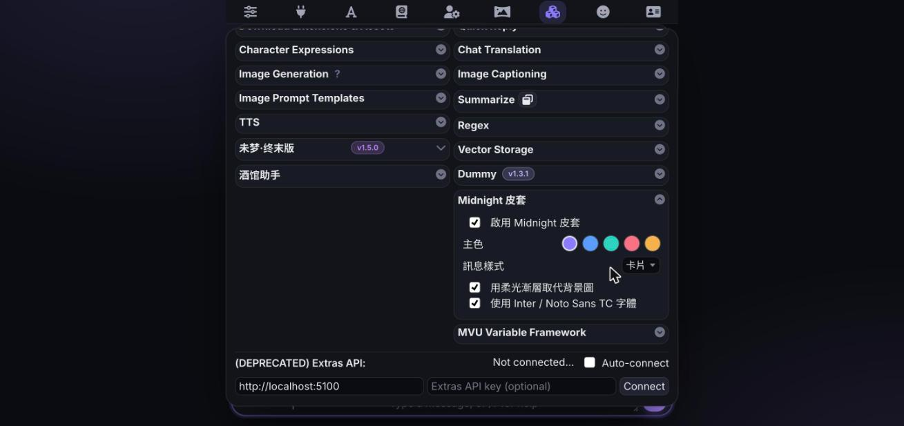

# Midnight（SillyTavern 現代深色皮套）v1.0.0

把 SillyTavern 預設的舊式介面換成現代深色風格：深藍灰底色、細邊框、大圓角、卡片式訊息、浮動輸入框、可切換強調色。只改酒館本身的外框，**不會動到角色卡自帶的 HTML / 美化內容**。



## 一鍵安裝

```
https://github.com/BoundlessEgret/SillyTavern-Midnight
```

1. 酒館頂部列點 **Extensions**（積木圖示）→ **Install extension**
2. 貼上上面的網址 → **Save**
3. 重新整理頁面，皮套會自動套用

透過 Install extension（Git）安裝的話，之後在 **Manage extensions** 可以直接更新。

### 手動安裝

把整個資料夾放到下面任一位置，再重新整理酒館：

- 只給目前使用者：`SillyTavern/data/<使用者>/extensions/SillyTavern-Midnight`
- 給所有使用者：`SillyTavern/public/scripts/extensions/third-party/SillyTavern-Midnight`

```bash
cd SillyTavern/data/default-user/extensions
git clone https://github.com/BoundlessEgret/SillyTavern-Midnight
```

## 設定

Extensions 面板 → **Midnight 皮套**

| 選項 | 說明 |
| --- | --- |
| 啟用 | 關掉立刻回到原版介面，不用重新整理 |
| 主色 | 紫 / 藍 / 青 / 玫瑰 / 琥珀 |
| 訊息樣式 | 卡片（每則訊息一張卡）或扁平 |
| 柔光漸層背景 | 用漸層取代背景圖；想保留自己的背景圖就關掉 |
| 字體 | 使用 Inter + Noto Sans TC（從 Google Fonts 載入） |

## 相容性

- 測試環境：SillyTavern 1.19.0，最低需求 1.12.0
- 所有樣式都包在 `body.midnight` 底下，並覆寫酒館的 `--SmartTheme*` 顏色變數，所以使用者設定裡的 UI 佈景主題顏色在啟用時會被取代
- 如果在使用者設定裡開了「No Blur」，面板維持不透明，不會有毛玻璃效果
- 文件模式（Document style）的聊天不套卡片樣式

## 授權

[MIT License](LICENSE.md) · Copyright (c) 2026 FR0MK3YT0E2D
